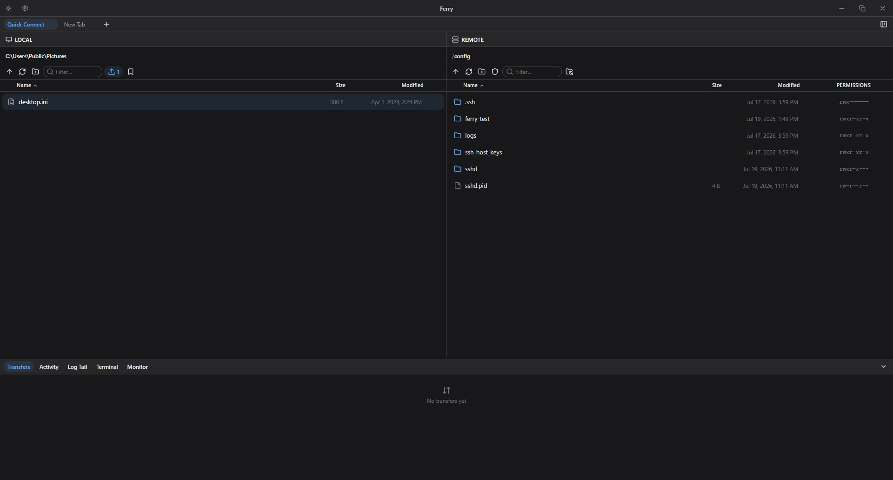
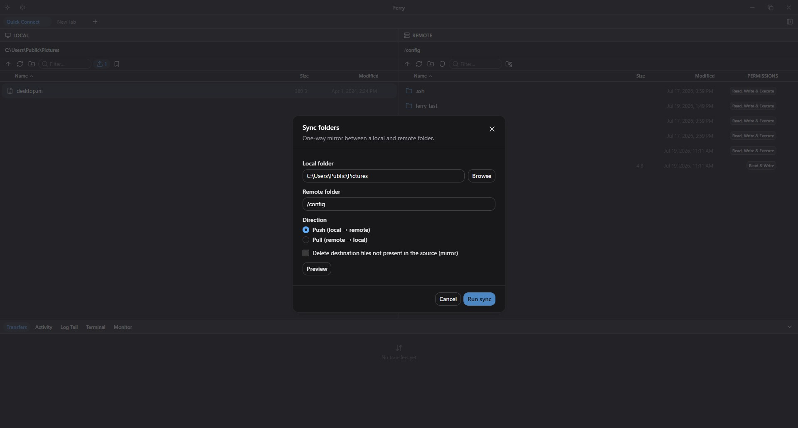
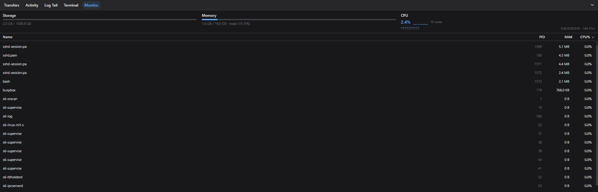
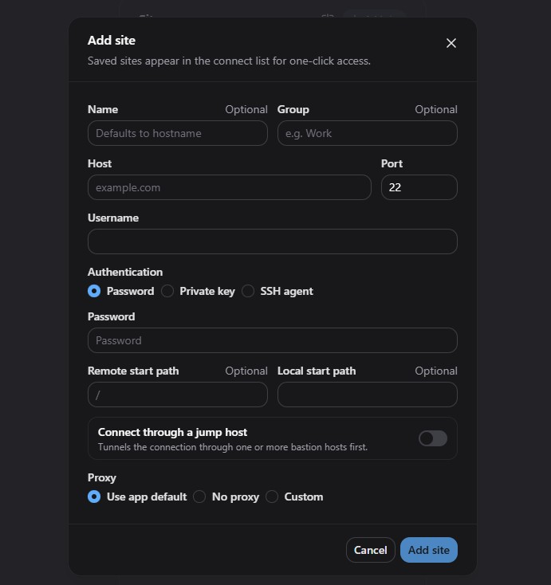
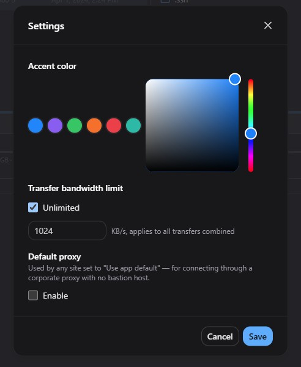

# Ferry

**A lightweight Windows SSH/SFTP client for fast file transfers and remote server work.**

Ferry brings file management, terminal access, live logs, and server monitoring into one desktop application.

## Features

- **Dual-pane file browser:** Browse, transfer, rename, delete, and manage local and remote files.
- **File transfers:** Upload and download folders, retry failed transfers, and control bandwidth.
- **SSH terminal:** Work directly on connected servers without switching tools.
- **Live logs:** Follow server logs as they change.
- **Server monitor:** See CPU, memory, disk usage, and running processes.
- **Connection management:** Use passwords, SSH keys, SSH agents, jump hosts, and proxies.
- **Modern workflow:** Multiple connection tabs, command palette, dark mode, and saved sessions.

## Screenshots

| Connection settings | Appearance settings |
|---|---|
|  |  |

## Download

**Windows 10 or later, x64.** Download the latest `Ferry-Setup-*.exe` installer from the [Releases](../../releases) page once public distribution begins. Until then, existing builds are available from the [original Ferry releases](https://github.com/ThienNg65/ferry/releases).

Ferry currently distributes an unsigned installer. Windows SmartScreen may ask you to confirm before running it.

Updates are delivered through GitHub Releases. Existing users of older versions may need to install a bridge version before updates are served from this repository.

## Support

Use [GitHub Issues](../../issues) for bugs and feature requests. Do not include passwords, private keys, or sensitive server details in issue reports.

## License

See [LICENSE](LICENSE). Historical source releases were distributed under the MIT License; downloading an installer does not change rights already granted to earlier source releases.

---
Built and maintained by [ThienNg65](https://github.com/ThienNg65).
